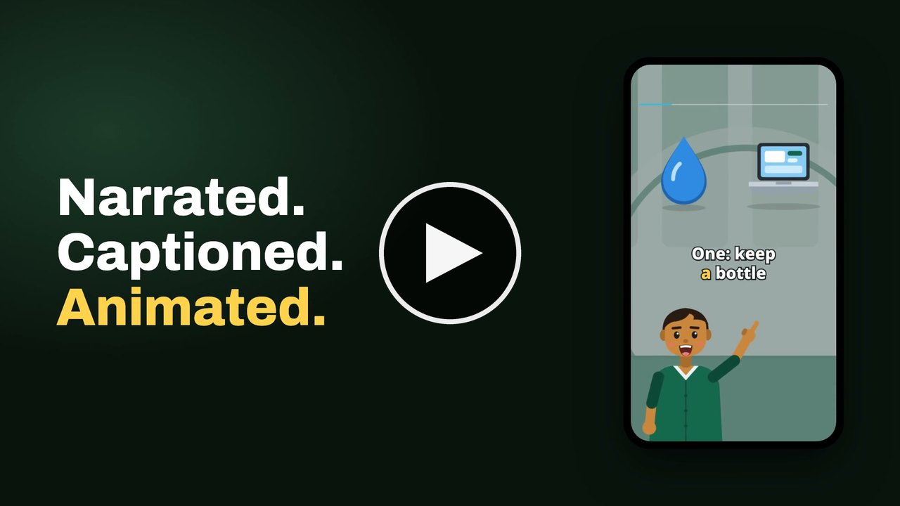
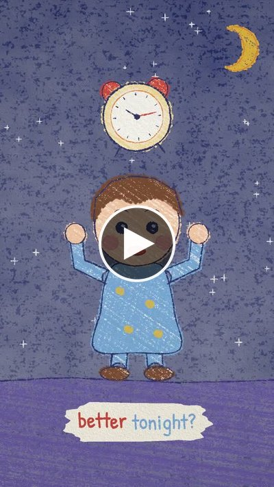
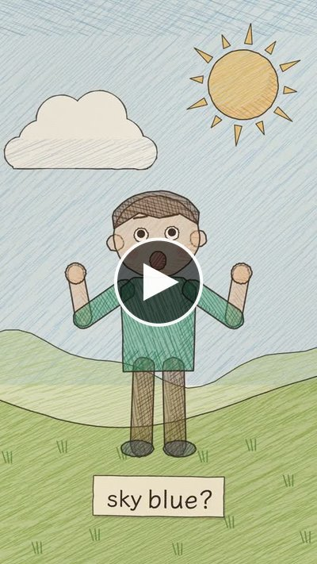

<p align="center"></p>

<h1 align="center">genreel</h1>

<p align="center">Describe it. Your own Claude Code makes the video.<br>
Made by <a href="https://github.com/rashidrashiii">@rashidrashiii</a> · <a href="https://github.com/rashidrashiii/GenReel">github.com/rashidrashiii/GenReel</a></p>

Describe a video in a sentence. **Your own Claude Code** writes the script, you check it shot by shot, and it makes a narrated, captioned, animated video on your computer, ready for Reels, Shorts or a status update.

genreel is free and open source. Nothing runs on anyone else's server. Your Claude Code does the work, on your own Claude plan.

<p align="center"><a href="https://cdn.jsdelivr.net/gh/rashidrashiii/GenReel@main/docs/media/launch.mp4"></a><br>
<sub>Click to play the 20-second tour.</sub></p>

## Made with genreel
Each of these was one sentence typed into genreel. Claude Code (Opus 5.5) wrote the script, chose a [lemo-opuscar](#optional-lemo-opuscar) film style and made the video in about 10 minutes, with the free local voice.

| [](https://cdn.jsdelivr.net/gh/rashidrashiii/GenReel@main/docs/media/honeybee.mp4) | [](https://cdn.jsdelivr.net/gh/rashidrashiii/GenReel@main/docs/media/sleep.mp4) | [](https://cdn.jsdelivr.net/gh/rashidrashiii/GenReel@main/docs/media/sky.mp4) |
|:-:|:-:|:-:|
| **How a honeybee makes honey**<br>Mid-century cartoon, 25 s | **Three tips to sleep better tonight**<br>Crayon picture book, 28 s | **Why is the sky blue?**<br>Coloured-pencil science, 27 s |

<sub>Click a picture to play it. These copies are compressed for GitHub; your own videos come out at full quality.</sub>

## What you need
- **Claude Code**, installed and signed in (`npm install -g @anthropic-ai/claude-code`, then run `claude` once).
- **Node.js 20+**
- **ffmpeg** (7 or newer if you add lemo-opuscar)
- **Python 3.10 to 3.13**, only for the free voice

genreel checks these on its Setup page and installs everything else itself:
- the video renderer, about 400 MB;
- the free voice, about 350 MB.

## Start
```bash
npx genreel
```
Or from a clone: `git clone https://github.com/rashidrashiii/GenReel && cd GenReel && npm install && npm start`. It opens http://localhost:3311.

## How it works
1. **Describe:** your idea, the language, the length (15 to 90 s) and the shape (tall, square, wide).
2. **Check the script:** Claude Code (no tools, JSON only) writes short shots: the words, a drawing or your own photo, numbers, diagrams. You can change anything.
3. **Make the video:** genreel starts a Claude Code session in `~/genreel/projects/<id>/work` with the rules in that folder's `CLAUDE.md`. The session:
   1. records the voice;
   2. lays the shots on the words;
   3. renders the animated explainer (Remotion), or a film with lemo-opuscar if you installed it;
   4. looks at frames from each shot and fixes what's off.
   genreel then checks the file and re-encodes it (H.264/AAC, `+faststart`).

Every video stays editable. Change the script and make it again; the old video stays until the new one is ready.

## Voice
- **Free, on your computer:** Kokoro for English and Hindi.
- **ElevenLabs (optional):** add your own key in Settings for Malayalam, Tamil, or a more natural voice in any language. The free ElevenLabs plan works. The key stays in `~/genreel/settings.json` (owner-only file) and is sent only to ElevenLabs.

## Time and your Claude plan
| Model (Settings) | Typical video | Use of your plan |
|---|---|---|
| Sonnet (default) | 5 to 15 min | moderate |
| Opus | 20 to 60 min | a lot; Pro plans may hit their limit after one or two videos |

If your plan's limit is reached, genreel says so and you can try again later.

## Safety
- While it makes a video, genreel lets Claude Code run commands **without asking**, in a folder inside `~/genreel`. The rules tell it to write only there and never to change the installed tools.
- Your words go into the brief as data. The rules tell Claude never to follow instructions found in them.
- The app listens only on `127.0.0.1`. It refuses requests from other websites, and any Host other than localhost.

## Optional: lemo-opuscar
[lemo-opuscar](https://github.com/lemomo-ai/lemo-opuscar) is a Claude Code plugin with 99 film styles. Install it from the Setup page and Claude Code will make a film in one of its styles instead of the standard explainer. It takes longer and uses more of your plan.

Its guides are licensed CC BY-NC 4.0, with a grant for making your own films (commercial ones included). Read its licence before using it for client work.

## Files
Everything lives in `~/genreel` (change it with `GENREEL_HOME`):
- `projects/<id>/project.json`, `video.mp4`, `thumb.jpg`, `work/`
- `uploads/`
- `settings.json`
- `renderer/`
- `voices/`
- `python/`

Delete the folder to remove everything.

## Licences
genreel's code is MIT. See [THIRD_PARTY.md](THIRD_PARTY.md) for Remotion (free for individuals and small companies; larger companies need a Remotion company licence), Kokoro, fonts and the included music and sound effects.

## Contributing and feedback
Issues and pull requests are welcome at [github.com/rashidrashiii/GenReel](https://github.com/rashidrashiii/GenReel/issues). If genreel is useful to you, a star helps others find it.

## Develop
`npm run dev`, `npm run check` (types, lint, tests). See [CONTRIBUTING.md](CONTRIBUTING.md).
